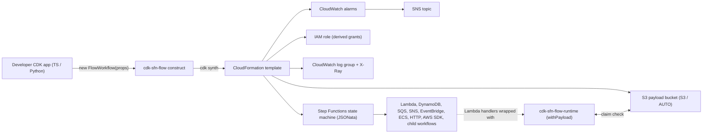
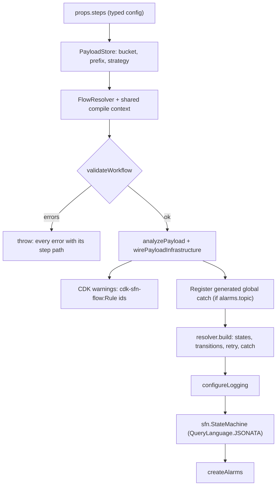
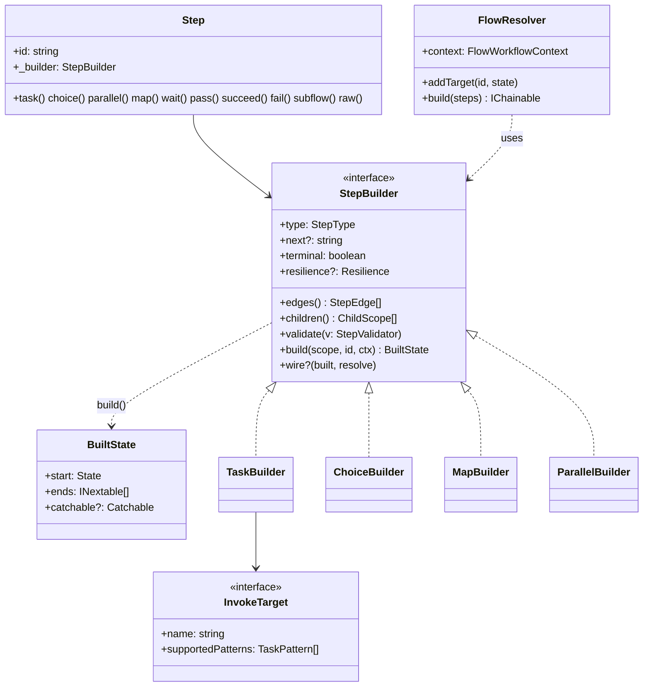
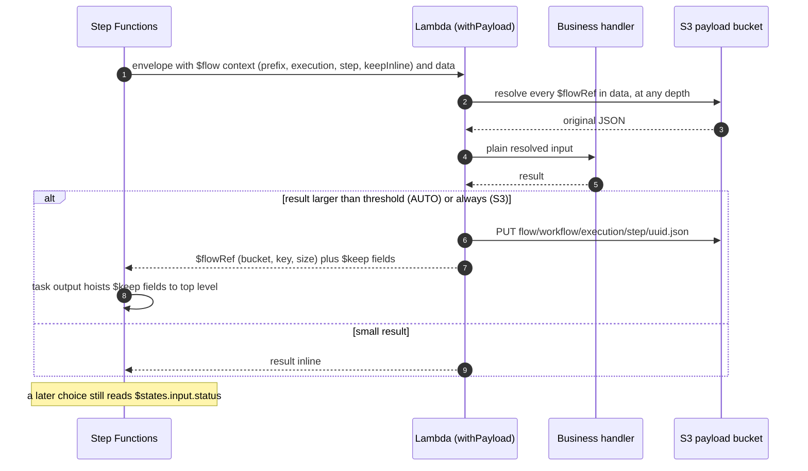
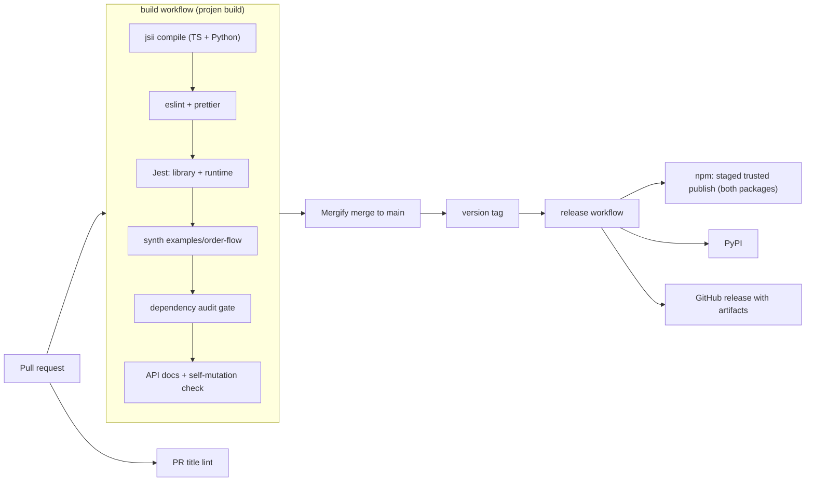

# cdk-sfn-flow — Architecture

**Describe behaviour, not states.** `cdk-sfn-flow` is an AWS CDK construct library. It compiles a small, typed
workflow config into a production-ready AWS Step Functions state machine (JSONata), and generates the parts
teams usually write and review by hand: state wiring, least-privilege IAM, retry/catch policy, large-payload
handling, Map mode selection, logging, tracing and alarms. Configuration mistakes fail at `cdk synth`, with
the path of the step that caused them.

| | |
|---|---|
| Repository | <https://github.com/gayanMadurapperuma/cdk-sfn-flow> |
| Packages | [`cdk-sfn-flow`](https://www.npmjs.com/package/cdk-sfn-flow) (npm + [PyPI](https://pypi.org/project/cdk-sfn-flow/)), [`cdk-sfn-flow-runtime`](https://www.npmjs.com/package/cdk-sfn-flow-runtime) (Lambda handlers) |
| Languages | TypeScript; Python bindings generated with jsii |
| Size | ~5k lines of TypeScript across 2 packages, 12 library test suites + runtime tests |
| Surface | 9 step types, 9 invoke families (Lambda, DynamoDB, SQS, SNS, EventBridge, ECS, HTTP, AWS SDK, subflow) |
| Effect | The reference order workflow drops from **120 → 64 lines**, and validation, payload safety, scoped grants and a global catch come with it |

---

## 1. Problem and design goals

Hand-written Step Functions code repeats the same work in every workflow, and the same mistakes:

- **Wiring**: `next()` chains, end states and choice defaults. A wrong reference only shows up at deploy time or at run time.
- **IAM**: permissions get either over-granted (`*`) or missed until the first execution fails.
- **Resilience**: retry/backoff/jitter and catch routing are copied from state to state.
- **The 256 KB payload limit**: workflows work in test and break in production when the data grows.
- **Map mode**: choosing between Inline and Distributed Map, setting up item readers and result writers.

Goals that shaped the design:

1. **Typed, behaviour-level config.** Authors say *what* happens. The library decides *how* it maps to states.
2. **Safe by default.** Built-in retry, logging, X-Ray, a hardened bucket and least-privilege grants, all of which the author can override.
3. **Fail at synth, not at runtime.** Report every config error in one pass, each with its step path.
4. **No lock-in.** Output is a plain `sfn.StateMachine`. `Step.raw` accepts any hand-written CDK state.
5. **Multi-language.** One codebase, published to TypeScript and Python.

---

## 2. System context

There are two deliverables with a shared contract:

- **Build time** (`cdk-sfn-flow`): a CDK construct that validates config and emits infrastructure.
- **Run time** (`cdk-sfn-flow-runtime`): a small Lambda library that resolves and offloads large payloads, using the envelope format and env vars the construct injects.

---

## 3. Code layout

| Path | Responsibility |
|---|---|
| `src/flow-workflow.ts` | The `FlowWorkflow` construct. Runs the compilation pipeline end to end. |
| `src/steps/*` | One module per step type (`task`, `choice`, `parallel`, `map`, `wait`, `pass`, `succeed`, `fail`, `subflow`, `raw`) plus the `Step` factory and the `StepBuilder` contract (`builder.ts`). |
| `src/invoke/*` | Service integrations behind one `InvokeTarget` interface: Lambda, DynamoDB, messaging (SQS/SNS/EventBridge), compute (ECS/HTTP/SDK). Each one declares its supported task patterns. |
| `src/compiler/resolver.ts` | `FlowResolver`: turns step lists into wired CDK states. |
| `src/compiler/validator.ts` | `validateWorkflow`: structural, graph and per-step validation. |
| `src/compiler/graph.ts` | Scope traversal (`allScopes`) and data-flow predecessors (`dataPredecessors`). |
| `src/compiler/payload*.ts` | `PayloadStore` (bucket, prefix, env) and payload wiring/analysis. |
| `src/observability.ts` | Logging, alarms, and the generated global catch (`FlowNotifyFailure → FlowFailed`). |
| `src/defaults.ts` | Built-in retry policy and catch defaults. |
| `runtime/src/*` | `withPayload`, Middy middleware, `resolveRefs` / `offload`. |
| `examples/order-flow` | End-to-end example app, synthesised in CI, with an integ test. |

---

## 4. Compilation pipeline

The construct works like a small compiler. Config is the source program, and CDK states are the target.
The order below follows the `FlowWorkflow` constructor.

Why this order:

- **Validate before building.** Nothing is created in the construct tree until the config is known to be valid, so errors are clean and not CDK stack traces.
- **Collect, don't throw early.** The validator gathers *all* problems and reports them together. Users fix a config in one iteration, not N.
- **Warnings are acknowledgeable.** Each risky pattern has a stable id (`cdk-sfn-flow:UnreachableStep`, `cdk-sfn-flow:ChoiceReadsOffloadedInput`, …), so teams can accept one deliberately with `Annotations.acknowledgeWarning`.

---

## 5. Core abstractions

The compiler is generic. Each step type and each service integration is a plugin behind a narrow interface,
so adding a new step or invoke doesn't touch the resolver or the validator.

Key ideas (`src/steps/builder.ts`):

- **`edges()` / `children()`** describe the graph *declaratively*. The validator and the payload analysis use them without building any CDK state.
- **`build()`** returns a `BuiltState`. It separates the entry state (`start`), the states that need a `next` (`ends`) and the state that takes retry/catch (`catchable`). That way a multi-state step, such as a Lambda task plus its claim-check output handling, still behaves as one node.
- **`resilience`** is present only on `task`, `parallel`, `map` and `subflow`. The resolver merges it over `defaults`.

---

## 6. Flow resolution

`FlowResolver.buildList` (`src/compiler/resolver.ts`) works one scope at a time: the top level, each parallel branch and each map iterator.

1. Build every step in the list into a `BuiltState`.
2. For non-terminal steps, wire `ends` to `next`, or else to the next array element, or else to the end of the list. `'end'` stops the list explicitly. `choice`, `succeed` and `fail` are terminal.
3. Apply resilience. The step's retry, merged over `defaults.retry` (built-in: `States.TaskFailed` + Lambda service errors, 3 attempts, 2 s, backoff 2, full jitter). Then the step's catches, or for top-level steps `defaults.catchErrors` or the generated SNS-notify global catch.
4. Call `wire()` for transitions that aren't `next` (choice branches and `otherwise`).

Nested lists are built through the shared context (`ctx.buildSteps`), so branches and iterators reuse exactly the same rules.
Step paths such as `Enrich > pricing > GetPrice` come from `allScopes` (`src/compiler/graph.ts`), and every error message uses them.

---

## 7. Validation design

Validation has three layers, and all of them run at synth time:

| Layer | Examples |
|---|---|
| **Structural** | Duplicate or reserved ids, unknown or cross-scope targets, empty step lists, parallel needs ≥ 2 uniquely named branches, choice needs `otherwise`. |
| **Semantic / per step** | Task pattern supported by the invoke, EXPRESS restrictions (no `SYNC`/`CALLBACK`, no Distributed Map), Map option compatibility, `https://` for HTTP, SDK naming, JSONata fields wrapped in ``. |
| **Graph and data flow** | Unreachable steps, choice loops without a `wait`, callback without timeout, and in S3/AUTO mode, reads of fields that may have been offloaded to S3. |

The data-flow checks use `dataPredecessors` (`src/compiler/graph.ts`). Catch edges are skipped because they carry error output, not data.
The checks follow values through `choice`, `wait` and `pass` (which pass references through unchanged).
That is how the library can warn at synth time: *"this `choice` reads `$states.input.total`, but the
Lambda before it may have offloaded its output and `total` isn't in `keepInline`"*. Without the check, this bug
appears only in production, when a payload first goes over the threshold.

Full rule list: [docs/validation-rules.md](docs/validation-rules.md). Every rule has a test.

---

## 8. Large payloads: the claim-check pattern

Step Functions limits state input/output to 256 KB. With `PayloadStrategy.S3` or `AUTO`, the construct and
the runtime library work together so that handlers never see the difference.

Infrastructure the construct creates for this:

- A bucket with SSE-S3, public access blocked, SSL enforced, and lifecycle expiry under `flow/` after `retentionDays`. Teams can bring their own bucket instead.
- `s3:GetObject` / `s3:PutObject` on `flow/<workflow-name>/*` only, for every referenced Lambda.
- `FLOW_PAYLOAD_*` env vars injected into each `lambda.Function`, with warnings for aliases and imported functions, where this can't be done automatically.

Design choices:

- **The contract is data, not code.** `$flowRef` is a plain S3 location, so other stores (e.g. `middy-store`) can interoperate.
- **Only Lambda resolves references.** Non-Lambda tasks (DynamoDB, SQS, …) would receive a reference object. The validator flags these reads instead of hiding the problem.
- **No-op when off.** With no env vars and no envelope, `withPayload` is a passthrough, so handlers are portable.

Details: [docs/payload-strategy.md](docs/payload-strategy.md).

---

## 9. Security and IAM model

- **Grants are derived, not declared.** Each invoke grants exactly what it calls. `Invoke.sdk` and DynamoDB get the single action on the resources passed in (`dynamodb:GetItem` on the table, not `dynamodb:*`).
- **Prefix-scoped storage.** Payload and Distributed Map result grants are limited to the workflow's own prefix.
- **One unavoidable wildcard.** `states:InvokeHTTPEndpoint` requires `*` as its resource. It is narrowed with an endpoint condition. `Invoke.sdk` on `*` produces a warning.
- **Encryption.** Optional customer-managed KMS key for state machine data. KMS on a user-supplied bucket is granted to the functions.
- **Logging hygiene.** Execution data is *not* logged by default (`includeData: false`), to avoid leaking payloads into logs.
- **Supply chain.** A dependency audit gate runs in the build (`build-tools/audit-check.js`), with a reviewed, dated allowlist (`.audit-allowlist.json`). Releases use npm trusted publishing (OIDC), not long-lived tokens.

---

## 10. Observability

| Concern | Default |
|---|---|
| Execution logs | Log group, 30-day retention, `ERROR` level, no execution data, `RETAIN` on delete |
| Tracing | X-Ray on |
| Alarms (opt-in) | `ExecutionsFailed`, `ExecutionsTimedOut`, optional `ExecutionThrottled`, actions to SNS |
| Failure notification | If `alarms.topic` is set and there's no custom catch, every top-level step catches into `FlowNotifyFailure` (SNS publish of the error), then `FlowFailed` |

---

## 11. Quality and delivery

- **Tests** cover the resolver, every validation rule, each invoke's IAM output, map modes, parallel/subflow, observability, payload wiring and the runtime (with an S3 mock).
- **The README example is a snapshot test** (`test/readme-example.test.ts`), so the documentation can't drift from real behaviour.
- **Compatibility**: a `compat` task (`jsii-diff`) checks the public API against the last release, and `aws-cdk-lib` is a peer dependency (≥ 2.273.0).
- **Projen** owns the project config, so build, release and upgrade workflows are generated and stay consistent.

---

## 12. Key decisions and trade-offs

| Decision | Rationale | Trade-off |
|---|---|---|
| **JSONata only** (no JSONPath) | JSONata is the modern Step Functions query language. It has variables (`assign`) and expressions, and lets the library hoist `$keep` fields with one output expression. | Older JSONPath workflows need migration. `Step.raw` covers edge cases. |
| **Compiler with plugins** (`StepBuilder`, `InvokeTarget`) | New steps and integrations are added without touching the core. Validation and analysis run over a declarative graph. | A little more indirection than building states directly. |
| **Synth-time validation that collects all errors** | Shortest feedback loop, and errors carry the user's vocabulary (step paths), not CDK internals. | Expressions inside `` are only checked for wrapping, not evaluated. |
| **Claim check as a runtime library** (not a Lambda layer or extension) | Explicit, testable and portable. Works with plain handlers or Middy, and is a no-op when the strategy is off. | Handlers must be wrapped. Only Node.js today (Python runtime is on the roadmap). |
| **Automatic Inline vs Distributed Map** | `MapItems.fromS3` implies Distributed. Otherwise Inline. Removes a common source of misconfiguration. | `mode` can force either one when needed. |
| **Typed config objects before YAML** | Type safety and IDE help in TS and Python first. A YAML/JSON loader can sit on top of the same model later. | Non-developers can't author workflows yet. |
| **jsii** | One implementation, published to npm and PyPI. | jsii constrains the API surface (no union types or generics in the public API). |

---

## 13. My contribution

I am the sole author of this project. I designed it and built all of it:

- **Architecture**: the compiler pipeline, the `StepBuilder` / `InvokeTarget` plugin model, scope and step-path resolution, and the data-flow analysis behind the payload warnings.
- **Implementation**: both packages (`cdk-sfn-flow` and `cdk-sfn-flow-runtime`): all step types, all invoke integrations with least-privilege IAM, the claim-check wire format, and observability.
- **Quality**: the test suites (every validation rule is tested), the snapshot-tested README example, and the `examples/order-flow` app synthesised in CI.
- **Delivery and security**: the projen/jsii build, the dependency audit gate with a reviewed allowlist, Mergify, and the release pipeline (npm trusted publishing with staged releases, PyPI, GitHub releases).
- **Documentation**: the README, API reference, payload strategy guide, validation rule catalogue, and the plain-CDK comparison.

You can verify this in the commit history at <https://github.com/gayanMadurapperuma/cdk-sfn-flow/commits/main>.

---

## 14. Roadmap

- YAML/JSON config loader on top of the typed model
- Python port of `cdk-sfn-flow-runtime`
- More invoke targets (Glue, Batch, Bedrock, CodeBuild)
- `middy-store` reference adapter
- Linking subflow executions to their parent
